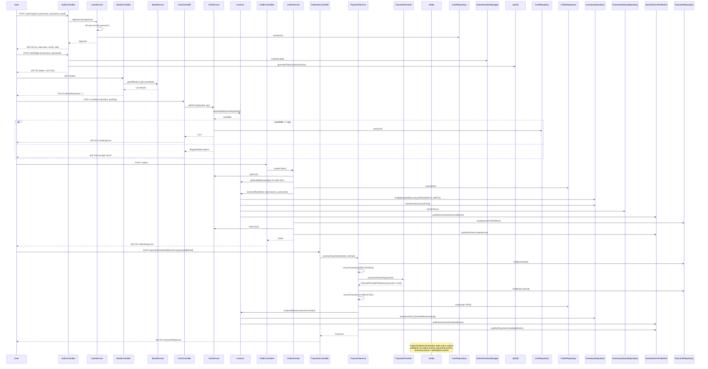
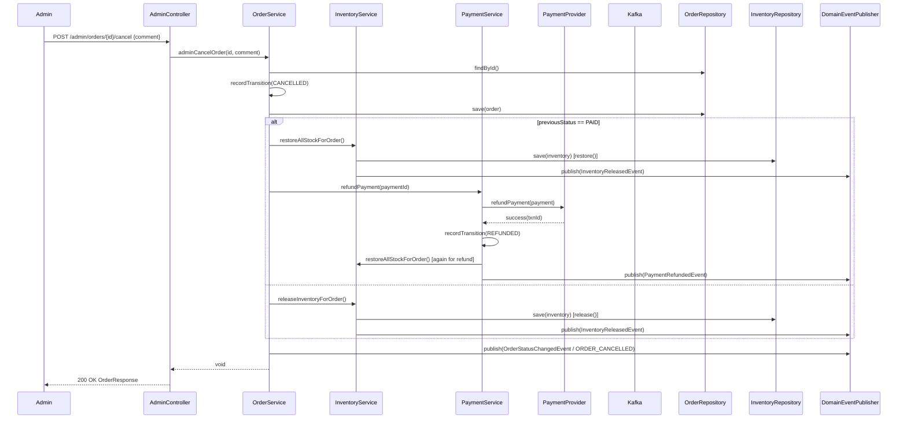
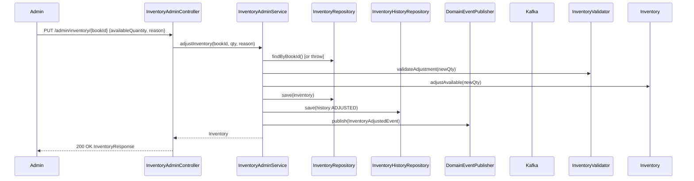

# Bookstore API Architecture Documentation

## 1. Executive Summary & System Boundaries

### Purpose & Scope
The Bookstore API is a production-ready Spring Boot 4.0 REST API implementing an online bookstore with complete order lifecycle management. The system handles user authentication, book catalog management, shopping cart operations, order processing, payment handling, inventory management with optimistic locking, event-driven architecture via Kafka and Outbox Pattern, distributed rate limiting, and comprehensive observability.

### Target Actors
- **End Users**: Customers browsing books, managing cart, placing orders, making payments
- **Administrators**: Managing books, inventory, orders, payments via admin endpoints
- **External Systems**: Payment providers (via DummyPaymentProvider interface), notification systems (email), monitoring systems (Prometheus, Grafana, Tempo)
- **CI/CD Pipeline**: Automated testing, security scanning, container building, Kubernetes deployment

### System Boundaries
**Inside this codebase:**
- Complete Spring Boot application with all business logic
- Database schema migrations (Flyway)
- Kubernetes deployment manifests (Kustomize overlays for dev/staging/prod)
- GitHub Actions CI/CD pipelines
- Docker multi-stage build
- Monitoring dashboards (Grafana) and alerting rules

**External Dependencies:**
- PostgreSQL 16 (database)
- Redis 7 (caching, rate limiting, session)
- Apache Kafka 4.0 (event streaming)
- SMTP server (email notifications - optional, logging sender by default)

### High-Level Paradigm
Modular Monolith with event-driven internal communication. Single deployable unit with clear domain boundaries, using Outbox Pattern for reliable event publishing to Kafka. Deployed as containerized workload on Kubernetes with horizontal pod autoscaling.

---

## 2. Project Structure & File Organization

### Root Directory Layout
```
bookstore/
├── .github/
│   ├── workflows/          # CI/CD pipelines (ci.yml, reusable-*.yml, codeql-analysis.yml)
│   ├── actions/java-setup/ # Reusable Java/Maven setup action
│   ├── dependabot.yml      # Dependency update automation
│   └── modernize/          # Java upgrade hooks
├── .mvn/wrapper/           # Maven wrapper
├── .vscode/                # VS Code settings and launch configs
├── grafana/
│   ├── dashboards/         # Grafana dashboard JSON definitions
│   └── datasources/        # Prometheus/Tempo datasource configs
├── k8s/
│   ├── overlays/           # Kustomize overlays (dev, staging, prod)
│   └── monitoring/         # Prometheus, Grafana, Tempo K8s manifests
├── perf/                   # Performance testing scripts (k6, Java baseline)
├── src/
│   ├── main/java/...       # Application source code
│   ├── main/resources/     # Config, DB migrations, email templates
│   └── test/java/...       # Test suites (unit, integration, chaos)
├── tempo.yml               # Tempo tracing config
├── prometheus.yml          # Prometheus scraping config
├── docker-compose.yml      # Local development stack
├── Dockerfile              # Multi-stage production build
├── pom.xml                 # Maven project definition
├── checkstyle.xml          # Code style rules
├── pmd-ruleset.xml         # PMD rules
├── owasp-suppressions.xml  # OWASP dependency check suppressions
└── README.md
```

### Logical Folder Architecture (src/main/java/com/example/bookstore)

```
com.example.bookstore
├── BookstoreApplication.java          # Spring Boot entry point
├── config/                            # Configuration classes
│   ├── jwt/                           # JWT utilities and filter
│   ├── ActuatorConfig.java            # Health indicators, info contributors
│   ├── CacheConfig.java               # Redis cache manager with TTLs
│   ├── CorrelationIdFilter.java       # MDC correlation ID filter
│   ├── DeadLetterService.java         # Kafka DLQ publisher
│   ├── ErrorResponse.java             # Standardized error response DTO
│   ├── FlywayConfig.java              # Flyway migration runner
│   ├── GlobalExceptionHandler.java    # @RestControllerAdvice
│   ├── InventoryProperties.java       # @ConfigurationProperties for inventory thresholds
│   ├── KafkaConfig.java               # Kafka producer/consumer factories, error handler
│   ├── KafkaTopicConfig.java          # Topic definitions (orders, payments, inventory, notifications, DLT)
│   ├── OpenApiConfig.java             # Swagger/OpenAPI config with JWT auth
│   ├── RateLimitingConfig.java        # Redis-backed sliding window rate limiter filter
│   ├── RedisRateLimiter.java          # Lua script-based rate limiter
│   └── SecurityConfig.java            # Spring Security filter chain, CORS, method security
├── controller/                        # REST controllers
│   ├── dto/                           # Request/Response DTOs with validation
│   ├── AdminController.java           # Admin order management
│   ├── AdminPaymentController.java    # Admin payment management
│   ├── AuthController.java            # Register, login, /me
│   ├── BookController.java            # Public book catalog, admin CRUD
│   ├── CartController.java            # Cart operations (user-scoped)
│   ├── InventoryAdminController.java  # Admin inventory management
│   ├── OrderController.java           # User order operations
│   └── PaymentController.java         # User payment operations
├── event/                             # Domain events and Outbox pattern
│   ├── publisher/                     # OutboxEventPublisher, OutboxPublisherScheduler
│   ├── repository/                    # EventOutboxRepository, ProcessedEventRepository
│   ├── BaseEvent.java                 # Abstract base with UUID, timestamp
│   ├── EventTypes.java                # Event type constants
│   ├── EventOutbox.java               # Outbox entity (JSONB payload)
│   ├── InventoryAdjustedEvent.java
│   ├── InventoryFinalizedEvent.java
│   ├── InventoryReleasedEvent.java
│   ├── InventoryReservedEvent.java
│   ├── OrderCreatedEvent.java
│   ├── OrderStatusChangedEvent.java
│   ├── OutboxCleanupScheduler.java    # Scheduled cleanup of published events
│   ├── OutboxStatus.java              # PENDING, PUBLISHED, FAILED
│   ├── PaymentCompletedEvent.java
│   ├── PaymentFailedEvent.java
│   ├── PaymentRefundedEvent.java
│   └── ProcessedEvent.java            # Idempotency tracking (composite PK)
├── exception/                         # Custom exceptions
│   ├── InvalidPaymentStateException.java
│   └── PaymentException.java
├── messaging/                         # Kafka messaging infrastructure
│   ├── consumer/                      # AbstractIdempotentConsumer + 4 concrete consumers
│   ├── metrics/                       # MessagingMetrics (Micrometer counters/timers)
│   ├── DomainEventEnvelope.java       # Record for Kafka message envelope
│   └── EnvelopeConverter.java         # JSON serialization/deserialization
├── model/                             # JPA entities and enums
│   ├── AppUser.java                   # Implements UserDetails
│   ├── Book.java                      # @Deprecated stock field, @Version for optimistic locking
│   ├── Cart.java                      # OneToOne with user, OneToMany with CartItem
│   ├── CartItem.java                  # priceAtAdd captures price at time of add
│   ├── EmailLog.java                  # Email audit trail
│   ├── EmailStatus.java               # PENDING, SENT, FAILED
│   ├── Inventory.java                 # availableQuantity, reservedQuantity, @Version
│   ├── InventoryEventType.java        # CREATED, RESERVED, RELEASED, FINALIZED, RESTORED, ADJUSTED
│   ├── InventoryHistory.java          # Full audit trail of inventory changes
│   ├── InventoryStatus.java           # AVAILABLE, LOW_STOCK, CRITICAL_STOCK, OUT_OF_STOCK
│   ├── Order.java                     # @Version, status transitions, payment 1:1
│   ├── OrderItem.java                 # unitPrice, subtotal, @PrePersist recalculation
│   ├── OrderStatus.java               # PENDING→PAID→PROCESSING→SHIPPED→DELIVERED, CANCELLED
│   ├── OrderStatusHistory.java        # Status transition audit
│   ├── Payment.java                   # State machine with PaymentStatus transitions
│   ├── PaymentHistory.java            # Payment status transition audit
│   ├── PaymentStatus.java             # State machine: PENDING→PROCESSING→COMPLETED/FAILED, REFUND_PROCESSING→REFUNDED
│   └── UserRole.java                  # ROLE_USER, ROLE_ADMIN
├── notification/                      # Email notification subsystem
│   ├── config/AsyncConfig.java        # @EnableAsync with ThreadPoolTaskExecutor
│   ├── email/                         # EmailSender interface + Logging/SMTP implementations
│   ├── event/NotificationEventHandler.java (consumes events, sends emails)
│   ├── model/EmailLog.java, EmailStatus.java
│   ├── repository/EmailLogRepository.java
│   └── template/EmailTemplateEngine.java (classpath template loading, {{placeholder}} replacement)
├── repository/                        # Spring Data JPA repositories
│   ├── BookRepository.java            # findByCategory, findByTitleOrAuthor
│   ├── CartItemRepository.java
│   ├── CartRepository.java            # findByUserId
│   ├── EmailLogRepository.java
│   ├── InventoryHistoryRepository.java # findByBookId, findByOrderId, findByEventType
│   ├── InventoryRepository.java       # findByBookIdWithLock (PESSIMISTIC_WRITE), findLowStock
│   ├── OrderRepository.java           # findByUserId (Page), findByStatus (Page), findByIdAndUserId
│   ├── OrderStatusHistoryRepository.java
│   ├── PaymentHistoryRepository.java
│   ├── PaymentRepository.java         # findByOrderId, findByPaymentStatus (Page)
│   ├── UserRepository.java            # findByUsername
│   └── event/ (see event/repository)
├── service/                           # Business logic layer
│   ├── payment/                       # PaymentProvider interface + DummyPaymentProvider
│   ├── AuditService.java              # Structured audit logging (AUDIT logger)
│   ├── BookService.java               # @Cacheable on getAllBooks, getById, search, category
│   ├── CartService.java               # Cart operations with inventory validation
│   ├── InventoryAdminService.java     # Admin inventory adjustments, initialization
│   ├── InventoryService.java          # Core inventory ops with @Retryable optimistic locking
│   ├── InventoryValidator.java        # Validation logic for reservations/releases
│   ├── OrderService.java              # Order creation, cancellation, status transitions
│   ├── PaymentService.java            # Payment processing, refunds, state machine enforcement
│   └── UserService.java               # UserDetailsService, registration with BCrypt
└── metrics/BusinessMetrics.java       # Micrometer counters/timers for business KPIs
```

### Module/Package Breakdown

| Package | Responsibility | Key Classes |
|---------|----------------|-------------|
| `config` | Cross-cutting infrastructure configuration | SecurityConfig, CacheConfig, KafkaConfig, RateLimitingConfig, GlobalExceptionHandler |
| `controller` | HTTP request handling, DTO mapping, authorization | AuthController, BookController, CartController, OrderController, PaymentController, AdminController, AdminPaymentController, InventoryAdminController |
| `controller.dto` | Request/Response contracts with Bean Validation | BookRequest, BookResponse, LoginRequest, RegisterRequest, AddToCartRequest, ProcessPaymentRequest, etc. |
| `event` | Domain events, Outbox pattern, event publishing | BaseEvent, EventOutbox, OutboxEventPublisher, OutboxPublisherScheduler, *Event classes |
| `event.publisher` | Outbox implementation | DomainEventPublisher (interface), OutboxEventPublisher, OutboxPublisherScheduler |
| `event.repository` | Outbox persistence | EventOutboxRepository, ProcessedEventRepository |
| `messaging` | Kafka consumer infrastructure | AbstractIdempotentConsumer, OrderEventConsumer, PaymentEventConsumer, InventoryEventConsumer, NotificationEventConsumer |
| `messaging.consumer` | Concrete Kafka consumers | 4 consumers with @KafkaListener, idempotency via ProcessedEventRepository |
| `model` | JPA entities, enums, domain state machines | AppUser, Book, Cart, CartItem, Order, OrderItem, Payment, Inventory, InventoryHistory, *Status enums |
| `notification` | Email sending subsystem | EmailService, EmailSender (Logging/SMTP), EmailTemplateEngine, AsyncConfig |
| `repository` | Spring Data JPA repositories | 12 repositories extending JpaRepository with custom queries |
| `service` | Business logic, transactions, orchestration | UserService, BookService, CartService, OrderService, PaymentService, InventoryService, InventoryAdminService, InventoryValidator, AuditService |
| `service.payment` | Payment provider abstraction | PaymentProvider (interface), PaymentProviderResponse, DummyPaymentProvider |
| `metrics` | Business observability | BusinessMetrics (33 Micrometer instruments) |
| `exception` | Domain-specific exceptions | PaymentException, InvalidPaymentStateException |

### Dependency Management
- **Build Tool**: Maven 3.9+ (wrapper provided)
- **Parent**: spring-boot-starter-parent 4.0.7
- **Java**: 21 (enforced via maven-enforcer-plugin)
- **Key Dependencies**:
  - Spring Boot Starters: web, data-jpa, security, actuator, validation, mail, kafka, cache, data-redis, test
  - Database: PostgreSQL (runtime), H2 (test), Flyway (migrations)
  - JWT: jjwt-api/impl/jackson 0.12.3
  - OpenAPI: springdoc-openapi-starter-webmvc-ui 3.0.3 (swagger-ui overridden to 5.32.14)
  - Rate Limiting: bucket4j-core 8.10.1 (but uses custom Redis Lua script)
  - Observability: micrometer-registry-prometheus, OpenTelemetry (API, instrumentation, javaagent)
  - Test: Testcontainers 2.0.5 (PostgreSQL, Kafka, Redis), spring-boot-starter-test, spring-security-test, awaitility
- **Version Overrides** (beyond the Spring Boot BOM, patched for CVEs): netty 4.2.17.Final, Tomcat 11.0.25, PostgreSQL driver 42.7.12, swagger-ui 5.32.14
- **Quality Profiles** (Maven):
  - `ci`: checkstyle, PMD, SpotBugs, OWASP Dependency Check
  - `performance`: JUnit group "performance"
  - `chaos`: JUnit group "chaos"

---

## 3. High-Level Architecture & System Design

### Architectural Pattern
**Modular Monolith with Event-Driven Internal Communication**

The codebase follows a layered architecture within a single deployable unit:
1. **Presentation Layer**: REST Controllers (`controller/`) with DTOs
2. **Application Layer**: Service classes (`service/`) with `@Transactional` boundaries
3. **Domain Layer**: JPA Entities (`model/`) with embedded business logic (state machines, validation)
4. **Infrastructure Layer**: Repositories, Kafka, Redis, Email, Config

**Event-Driven Communication**: Services publish domain events via `DomainEventPublisher` → `OutboxEventPublisher` persists to `event_outbox` table → `OutboxPublisherScheduler` polls and publishes to Kafka → Consumers process with idempotency guarantees.

### Layer Separation

| Layer | Package | Responsibilities |
|-------|---------|------------------|
| **Presentation** | `controller/`, `controller/dto/` | HTTP routing, request validation, response mapping, `@PreAuthorize` security |
| **Application** | `service/` | Use case orchestration, transaction management, cross-domain coordination, metric recording |
| **Domain** | `model/` | Entity state, business invariants (state machines in `OrderStatus`, `PaymentStatus`), `@Version` optimistic locking |
| **Infrastructure** | `repository/`, `config/`, `messaging/`, `notification/` | Data access, external system integration, cross-cutting concerns |

### Communication & Contracts

**Synchronous (Request-Response)**:
- Controllers → Services: Direct method calls with Spring-managed transactions
- Controllers → Repositories: Only via Services (no direct repository access in controllers)

**Asynchronous (Event-Driven)**:
- **Outbox Pattern**: `DomainEventPublisher.publish(event, aggregateType, aggregateId, eventType)`
  - `OutboxEventPublisher` (implements interface) saves to `event_outbox` table in same transaction
  - `OutboxPublisherScheduler` (scheduled @ 1s) polls PENDING events, publishes to Kafka via `KafkaTemplate`
  - Topics: `orders.events`, `payments.events`, `inventory.events`, `notifications.events`, `dlt.events`
- **Kafka Consumers**: 4 consumer groups (`orders-consumer`, `payments-consumer`, `inventory-consumer`, `notifications-consumer`) extending `AbstractIdempotentConsumer`
  - Idempotency: `ProcessedEventRepository` with composite PK (eventId, consumerGroup)
  - Error Handling: `DefaultErrorHandler` with exponential backoff → `DeadLetterService` sends to DLT after max retries

**Internal Service Calls**:
- `OrderService` → `InventoryService.reserveAll()` → publishes `InventoryReservedEvent`
- `PaymentService` → `InventoryService.finalizeAllReservationsForOrder()` / `releaseAllReservationsForOrder()` / `restoreAllStockForOrder()`
- `InventoryAdminService` → `InventoryService.initializeInventory()`

### External Integrations

| Integration | Implementation | Configuration |
|-------------|----------------|---------------|
| **PostgreSQL** | Spring Data JPA + HikariCP | `spring.datasource.*`, pool size 2-10 |
| **Redis** | Spring Data Redis + Lettuce | `spring.data.redis.*`, cache TTLs per cache name |
| **Kafka** | Spring Kafka | `spring.kafka.*`, idempotent producer, 3 consumer threads |
| **Email** | Spring Mail + JavaMail | `spring.mail.*`, `LoggingEmailSender` (default), `SmtpEmailSender` (when host configured) |
| **Payment Provider** | `PaymentProvider` interface + `DummyPaymentProvider` | Pluggable, returns synthetic transaction IDs |
| **Prometheus** | Micrometer + Actuator | `/actuator/prometheus`, custom `BusinessMetrics` |
| **OpenTelemetry** | OTel Java Agent (downloaded at build) | `otel.*` config, OTLP/gRPC to Tempo |
| **Grafana** | Provisioned dashboards/datasources | JSON dashboards in `grafana/dashboards/` |

---

## 4. Domain Model & Core Business Logic

### Domain Concepts (Bounded Contexts)

1. **User Management**: Authentication (JWT), Authorization (RBAC: USER/ADMIN), Registration
2. **Catalog**: Books with categories, pricing, search; Redis caching
3. **Shopping Cart**: User-scoped cart with items, price captured at add time, inventory validation
4. **Order Management**: Order lifecycle (PENDING→PAID→PROCESSING→SHIPPED→DELIVERED), cancellation rules, status history audit
5. **Payment Processing**: Payment state machine, provider abstraction, refunds
6. **Inventory**: Available/reserved quantities, optimistic locking, low-stock alerts, full audit history
7. **Notifications**: Event-driven email sending with retry logic and audit log

### Data Structures & Entities

#### Core Entities (with key fields)

**AppUser** (`app_user` table)
- `id` (PK), `username` (unique), `password` (BCrypt), `email`, `role` (ROLE_USER/ROLE_ADMIN)
- Implements `UserDetails` for Spring Security

**Book** (`book` table)
- `id`, `title`, `author`, `price` (BigDecimal 19,4), `category`, `stock` (@Deprecated), `version` (optimistic locking)
- **Note**: `stock` field deprecated; `Inventory` table is source of truth

**Cart** (`cart` table)
- `id`, `user_id` (OneToOne), `items` (OneToMany cascade ALL, orphanRemoval)

**CartItem** (`cart_items` table)
- `id`, `book_id`, `cart_id`, `quantity`, `price_at_add` (BigDecimal), `added_at`
- `@PrePersist` captures `book.price` if null

**Order** (`orders` table)
- `id`, `user_id`, `created_at`, `total_price`, `status` (OrderStatus), `version`
- `items` (OneToMany OrderItem, EAGER), `statusHistory` (OneToMany, LAZY), `payment` (OneToOne, LAZY)
- Methods: `addItem()`, `calculateTotal()`, `recordTransition()`, `isCancelable()`

**OrderItem** (`order_items` table)
- `id`, `book_id`, `order_id`, `quantity`, `unit_price`, `subtotal`
- `@PrePersist` recalculates subtotal

**Payment** (`payment` table)
- `id`, `order_id` (OneToOne), `payment_provider`, `payment_method`, `payment_status`, `amount`, `currency`
- `transaction_id`, `external_payment_id`, `payment_reference`, `failure_reason`
- `created_at`, `updated_at`, `completed_at`, `version`
- `history` (OneToMany PaymentHistory)
- Method: `recordTransition()` enforces `PaymentStatus.canTransitionTo()`

**Inventory** (`inventory` table)
- `id`, `book_id` (unique), `available_quantity`, `reserved_quantity`, `last_updated`, `version`
- Methods: `reserve()`, `release()`, `finalizeReservation()`, `adjustAvailable()`, `restore()`, `getTotalQuantity()`
- All mutators validate preconditions and throw `IllegalStateException` on violation

**InventoryHistory** (`inventory_history` table)
- Full audit: `inventory_id`, `book_id`, `event_type` (InventoryEventType), previous/new available/reserved, `quantity_change`, `order_id`, `payment_id`, `changed_by`, `reason`, `created_at`

### Business Rules & Invariants

#### Order Status Transitions (`OrderStatus` enum)
```
PENDING → {PAID, CANCELLED}
PAID → {PROCESSING, CANCELLED}
PROCESSING → {SHIPPED}
SHIPPED → {DELIVERED}
DELIVERED → {} (terminal)
CANCELLED → {} (terminal)

isCancelable(): PENDING, PAID only
```

#### Payment Status Transitions (`PaymentStatus` enum)
```
PENDING → {PROCESSING, CANCELLED}
PROCESSING → {COMPLETED, FAILED}
COMPLETED → {REFUND_PROCESSING}
REFUND_PROCESSING → {REFUNDED, FAILED, COMPLETED}
FAILED → {PENDING}
CANCELLED → {} (terminal)
REFUNDED → {} (terminal)

canTransitionTo() enforces above; isTerminal(): CANCELLED, REFUNDED
```

#### Inventory Invariants (enforced in `Inventory` entity methods)
- `reserve(qty)`: `availableQuantity >= qty` else `IllegalStateException`
- `release(qty)`: `reservedQuantity >= qty` else `IllegalStateException`
- `finalizeReservation(qty)`: `reservedQuantity >= qty` else `IllegalStateException`
- `adjustAvailable(qty)`: `qty >= 0` else `IllegalArgumentException`
- `restore(qty)`: `qty > 0` else `IllegalArgumentException`
- `availableQuantity` and `reservedQuantity` never negative (DB CHECK constraints)

#### Cart Invariants
- `addToCart`/`updateCartItem`: Validates `inventoryService.getAvailableQuantity(bookId) >= requestedQty`
- Price captured at add time (`priceAtAdd`) - immutable for that cart item

#### Order Creation Invariants (`OrderService.createOrder()`)
1. Cart not empty
2. All items have sufficient inventory (`available >= cartItem.quantity`)
3. Atomic: reserve inventory → create order + order items → create payment (PENDING) → clear cart → publish OrderCreatedEvent

#### Concurrency Control
- **Optimistic Locking**: `@Version` on Book, Order, Payment, Inventory → `OptimisticLockingFailureException` → `@Retryable(maxAttempts=3, backoff=100ms*2)`
- **Pessimistic Locking**: `InventoryRepository.findByBookIdWithLock()` (PESSIMISTIC_WRITE) used in `InventoryService.reserveAll()` for batch reservations with sorted book IDs to prevent deadlocks

### Complex Algorithms

1. **Sliding Window Rate Limiting** (`RedisRateLimiter`): Lua script using Redis sorted sets (ZSET) with timestamps as scores. Atomic check-and-increment in single script execution.

2. **Batch Inventory Reservation with Deadlock Prevention** (`InventoryService.reserveAll()`):
   - Sorts book IDs ascending before locking
   - Uses `findByBookIdWithLock()` (PESSIMISTIC_WRITE) per book
   - Validates each, then reserves all in single transaction

3. **Outbox Pattern for Reliable Event Publishing**:
   - Event saved to `event_outbox` in same transaction as business operation
   - Separate scheduler polls and publishes to Kafka
   - Retry logic with exponential backoff, max 5 retries, then FAILED status
   - Cleanup scheduler removes PUBLISHED events older than 7 days

4. **Idempotent Kafka Consumption** (`AbstractIdempotentConsumer`):
   - `ProcessedEventRepository` with composite PK (eventId, consumerGroup)
   - `DataIntegrityViolationException` on duplicate → silent skip
   - Metrics recorded for consumed/failed/DLT events

---

## 5. Data Persistence & Storage Layer

### Storage Mechanism
- **Primary**: PostgreSQL 16 (relational)
- **ORM**: Spring Data JPA (Hibernate 6.x) with `@Entity` mapping
- **Migrations**: Flyway (8 versioned SQL scripts in `src/main/resources/db/migration/`)
- **Cache**: Redis 7 (Spring Cache abstraction + `StringRedisTemplate` for rate limiting)
- **Connection Pool**: HikariCP (min 2, max 10, configurable via `DB_POOL_MAX_SIZE`)

### Schema & Entities (from Flyway migrations)

| Table | Key Columns | Constraints |
|-------|-------------|-------------|
| `app_user` | id (PK), username (UK), password, email, role | username unique, role default 'ROLE_USER' |
| `book` | id (PK), title, author, price (19,4), category, stock (deprecated), version | - |
| `cart` | id (PK), user_id (FK→app_user, cascade DELETE) | - |
| `cart_items` | id (PK), book_id (FK→book), cart_id (FK→cart), quantity, price_at_add (19,4), added_at | FK cascade DELETE |
| `orders` | id (PK), user_id (FK→app_user), created_at, total_price (19,4), status, version | FK cascade DELETE |
| `order_items` | id (PK), book_id (FK→book), order_id (FK→orders), quantity, unit_price (19,4), subtotal (19,4) | FK cascade DELETE |
| `order_status_history` | id (PK), order_id (FK), previous_status, new_status, changed_by, comment, created_at | Index on order_id |
| `payment` | id (PK), order_id (FK, UK), payment_provider, payment_method, payment_status, amount (19,4), currency, transaction_id, external_payment_id, payment_reference, failure_reason, created_at, updated_at, completed_at, version | Unique index on order_id, index on payment_status, index on transaction_id |
| `payment_history` | id (PK), payment_id (FK), previous_status, new_status, changed_by, reason, created_at | Index on payment_id |
| `inventory` | id (PK), book_id (UK), available_quantity, reserved_quantity, last_updated, version | CHECK available>=0, CHECK reserved>=0, unique book_id, index on book_id |
| `inventory_history` | id (PK), inventory_id (FK), book_id (FK), event_type, previous_available, new_available, previous_reserved, new_reserved, quantity_change, order_id, payment_id, changed_by, reason, created_at | Indexes on inventory_id, book_id, order_id, event_type, created_at |
| `email_log` | id (PK), recipient, subject, body (TEXT), email_type, status, error_message, retry_count, sent_at, created_at | Index on status, index on email_type |
| `event_outbox` | id (UUID PK), aggregate_type, aggregate_id, event_type, event_version, correlation_id, trace_id, span_id, producer, payload (JSONB), metadata (JSONB), status, retry_count, created_at, published_at | Index on status, created_at, event_type |
| `processed_events` | event_id, consumer_group (composite PK), processed_at | Index on consumer_group |

### Relationships & Cardinality

```
AppUser (1) ←→ (1) Cart
AppUser (1) ←→ (N) Order
AppUser (1) ←→ (N) Payment (via Order)
Order (1) ←→ (N) OrderItem
Order (1) ←→ (1) Payment
Order (1) ←→ (N) OrderStatusHistory
Order (1) ←→ (N) InventoryHistory (via order_id)
Book (1) ←→ (N) CartItem
Book (1) ←→ (N) OrderItem
Book (1) ←→ (1) Inventory
Inventory (1) ←→ (N) InventoryHistory
Payment (1) ←→ (N) PaymentHistory
```

### Data Access Patterns

| Repository | Pattern | Notable Queries |
|------------|---------|-----------------|
| `BookRepository` | JpaRepository | `findByCategory`, `findByTitleOrAuthor` (LIKE) |
| `CartRepository` | JpaRepository | `findByUserId` |
| `OrderRepository` | JpaRepository | `findByUserId(Pageable)`, `findByStatus(Pageable)`, `findByIdAndUserId` |
| `InventoryRepository` | JpaRepository | `findByBookIdWithLock` (PESSIMISTIC_WRITE), `findLowStock`, `findOutOfStock` |
| `PaymentRepository` | JpaRepository | `findByOrderId`, `findByPaymentStatus(Pageable)` |
| `*HistoryRepository` | JpaRepository | `findBy*IdOrderByCreatedAtAsc` |

**Caching Strategy** (`CacheConfig`):
- `books` (10 min TTL): `getAllBooks()`, `getBooksByCategory()`, `searchBooks()`
- `bookById` (30 min TTL): `getBookById()`
- `inventory` (1 min TTL): `getInventory()`
- `inventoryAvailable` (30 sec TTL): `getAvailableQuantity()`
- Cache eviction on write operations (`@CacheEvict`)

### Migrations & Evolution
Flyway migrations (V1-V8) applied in order:
1. V1: Initial schema (users, books, carts, orders, order_items)
2. V2: Seed demo data (admin, testuser, 2 books)
3. V3: `order_status_history` table
4. V4: `payment`, `payment_history` tables + indexes
5. V5: `email_log` table + indexes
6. V6: `inventory`, `inventory_history` tables + data migration from `book.stock` + indexes
7. V7: `event_outbox`, `processed_events` tables + indexes
8. V8: `event_outbox.span_id` column (for W3C trace propagation) + index

### Caching & Indexing
- **Redis Caches**: 4 named caches with differentiated TTLs (see CacheConfig)
- **Database Indexes**:
  - Composite PK on `processed_events` (event_id, consumer_group)
  - Single-column indexes on FK columns, status columns, created_at
  - Unique constraints on `app_user.username`, `inventory.book_id`, `payment.order_id`

---

## 6. Application Layer & Backend Services

### API Architecture
- **Style**: RESTful with JSON request/response bodies
- **Versioning**: URL path `/api/v1/`
- **OpenAPI/Swagger**: `springdoc-openapi-starter-webmvc-ui` at `/swagger-ui.html`, `/v3/api-docs`
- **Base Path**: All endpoints under `/api/v1/`

### Routing Structure & Endpoints

| Controller | Base Path | Key Endpoints |
|------------|-----------|---------------|
| `AuthController` | `/api/v1/auth` | POST `/register`, POST `/login`, GET `/me` |
| `BookController` | `/api/v1/books` | GET `/`, GET `/search`, GET `/category`, GET `/{id}`, POST `/` (ADMIN), DELETE `/{id}` (ADMIN), PUT `/{id}/stock` (ADMIN) |
| `CartController` | `/api/v1/cart` | GET `/`, POST `/items`, PUT `/items/{bookId}`, DELETE `/items/{bookId}`, DELETE `/` |
| `OrderController` | `/api/v1/orders` | POST `/`, GET `/`, GET `/{id}`, POST `/{id}/cancel`, GET `/{id}/history` |
| `PaymentController` | `/api/v1/payments` | GET `/{orderId}`, POST `/{orderId}/process`, POST `/{orderId}/cancel`, GET `/{orderId}/history` |
| `AdminController` | `/api/v1/admin/orders` | GET `/`, GET `/{id}`, PUT `/{id}/status`, POST `/{id}/cancel`, GET `/{id}/history` |
| `AdminPaymentController` | `/api/v1/admin/payments` | GET `/`, GET `/{id}`, POST `/{id}/refund`, GET `/{id}/history` |
| `InventoryAdminController` | `/api/v1/admin/inventory` | GET `/`, GET `/{bookId}`, PUT `/{bookId}`, GET `/{bookId}/history`, GET `/low-stock`, GET `/out-of-stock`, GET `/status/{status}` |

### Middleware & Interceptors (Filter Chain Order)

1. **CorrelationIdFilter** (`@Order(HIGHEST_PRECEDENCE)`): Extracts/generates `X-Correlation-Id`, puts in MDC, adds to response header
2. **RateLimitingFilter** (`@Order(HIGHEST_PRECEDENCE + 1)`): Redis sliding window per IP+method+path-group
3. **Spring Security Filter Chain**: JWT authentication, authorization, CSRF disabled, stateless session
4. **GlobalExceptionHandler** (`@RestControllerAdvice`): Maps exceptions to standardized `ErrorResponse`

### Authentication & Authorization

**Authentication (AuthN)**:
- JWT-based stateless authentication
- `JwtAuthenticationFilter` extracts `Authorization: Bearer <token>` header
- `JwtUtil` validates signature (HS256), expiration, clock skew (30s), extracts username + roles
- `UserService` implements `UserDetailsService` for `AuthenticationManager`
- Login: `AuthenticationManager.authenticate()` → `JwtUtil.generateToken()` → returns token + user info
- Registration: Creates `AppUser` with BCrypt password, default `ROLE_USER`

**Authorization (AuthZ)**:
- `@EnableMethodSecurity` + `@PreAuthorize` on controllers
- Role-based: `hasRole('USER')` for cart/orders/payments, `hasRole('ADMIN')` for admin endpoints
- Public: `/api/v1/auth/**`, `/swagger-ui/**`, `/v3/api-docs/**`, GET `/api/v1/books/**`
- Actuator: `/actuator/health/**`, `/actuator/info` public; `/actuator/prometheus` ADMIN; other `/actuator/**` ADMIN

**JWT Configuration**:
- Secret: `${JWT_SECRET}` (min 32 bytes, validated at startup)
- Expiration: `${JWT_EXPIRATION:1800000}` (30 min default)
- Clock skew: `${JWT_CLOCK_SKEW_SECONDS:30}`
- Claims: `sub` (username), `roles` (comma-separated), `jti` (UUID), `iat`, `exp`

### Asynchronous Processing

| Component | Mechanism | Purpose |
|-----------|-----------|---------|
| **Kafka Consumers** | `@KafkaListener` (3 concurrency per group) | Process domain events from 4 topics |
| **Outbox Publisher** | `@Scheduled(fixedDelay=1s)` | Poll `event_outbox`, publish to Kafka |
| **Outbox Cleanup** | `@Scheduled(cron="0 0 3 * * ?")` | Delete PUBLISHED events > 7 days |
| **Email Sending** | `@Async("notificationTaskExecutor")` (2-5 threads) | Retry logic (3 attempts, exponential backoff) |
| **Cache Operations** | Spring Cache abstraction | Read-through on `@Cacheable`, evict on writes |

**Thread Pools**:
- Kafka listeners: 3 threads per consumer group (configured in `KafkaConfig`)
- Notification executor: Core 2, Max 5, Queue 100 (`AsyncConfig`)
- Tomcat: Default (configured via `server.tomcat.*` if needed)

### Error Handling Strategy

**GlobalExceptionHandler** maps exceptions to `ErrorResponse`:
| Exception | HTTP Status | Error Code |
|-----------|-------------|------------|
| `HttpMessageNotReadableException` | 400 | MALFORMED_BODY |
| `IllegalArgumentException` | 400 | (none) |
| `IllegalStateException` | 400 | (none) |
| `DataIntegrityViolationException` | 409 | DATA_CONFLICT |
| `MethodArgumentNotValidException` | 400 | VALIDATION_ERROR (with fieldErrors) |
| `OptimisticLockException` | 409 | CONCURRENT_MODIFICATION |
| `PaymentException` | 400 | PAYMENT_ERROR |
| `InvalidPaymentStateException` | 400 | INVALID_PAYMENT_STATE |
| `AccessDeniedException` | 403 | ACCESS_DENIED |
| `AuthenticationException` | 401 | AUTHENTICATION_FAILED |
| `Exception` (catch-all) | 500 | INTERNAL_ERROR |

**ErrorResponse Structure**:
```json
{
  "status": 400,
  "error": "Bad Request",
  "message": "Validation failed",
  "code": "VALIDATION_ERROR",
  "path": "/api/v1/books",
  "fieldErrors": [{"field": "title", "message": "Title is required"}]
}
```

---

## 7. Presentation Layer & Frontend (Not Applicable)

**Not applicable / Not present in the provided codebase** — This is a backend-only REST API. No frontend code, components, or styling present.

---

## 8. Cross-Cutting Concerns & Technical Patterns

### Design Patterns

| Pattern | Implementation | Location |
|---------|----------------|----------|
| **Outbox Pattern** | `EventOutbox` table + `OutboxEventPublisher` + `OutboxPublisherScheduler` | `event/`, `event/publisher/` |
| **Idempotent Consumer** | `ProcessedEvent` composite PK + `AbstractIdempotentConsumer` | `messaging/consumer/` |
| **State Machine** | `OrderStatus.canTransitionTo()`, `PaymentStatus.canTransitionTo()` | `model/OrderStatus.java`, `model/PaymentStatus.java` |
| **Strategy** | `PaymentProvider` interface + `DummyPaymentProvider` | `service/payment/` |
| **Template Method** | `PaymentService.initializeProcessing()`/`completeProcessing()`, `initializeRefund()`/`completeRefund()` | `service/PaymentService.java` |
| **Retry with Backoff** | `@Retryable` on inventory operations (optimistic lock failures) | `service/InventoryService.java` |
| **Circuit Breaker** | Not implemented (retry only) | N/A |
| **Decorator** | `EmailSender` interface with `LoggingEmailSender` (default) and `SmtpEmailSender` (@Primary when host configured) | `notification/email/` |
| **Builder** | `TestDataBuilder` (test utilities) | `test/builder/` |

### Configuration Management

| Mechanism | Usage |
|-----------|-------|
| **Spring Boot Profiles** | `application.yml` (base), `application-{dev,prod,staging,test,test-e2e,perf}.yml` |
| **Environment Variables** | All sensitive/configurable values via `${ENV_VAR:default}` |
| **@ConfigurationProperties** | `InventoryProperties` (inventory thresholds), `JwtUtil` fields |
| **ConfigMap/Secret (K8s)** | `bookstore-config` ConfigMap, `bookstore-secrets` Secret (ExternalSecret pattern for prod) |
| **Feature Flags** | `app.cache.enabled`, `app.rate-limiting.enabled`, `app.outbox.cleanup.enabled`, `spring.kafka.bootstrap-servers` presence |

### Security Measures

| Measure | Implementation |
|---------|----------------|
| **Input Validation** | Bean Validation (@NotNull, @NotBlank, @Size, @DecimalMin, @Positive, @Email) on DTOs + `@Valid` in controllers |
| **SQL Injection Prevention** | Spring Data JPA parameter binding, no raw SQL in repositories (only `@Query` with named parameters) |
| **Password Hashing** | BCrypt (strength 10) via `PasswordEncoder` bean |
| **JWT Security** | HS256, min 32-byte secret validated at startup, clock skew tolerance, short expiration (30 min) |
| **Rate Limiting** | Redis sliding window per IP+method+endpoint-group (auth: 5/min, checkout: 20/min, admin: 60/min, api: 100/min) |
| **CORS** | Configurable allowed origins, credentials enabled, max-age 1hr |
| **Security Headers** | X-Frame-Options: DENY, HSTS (1 year), no cache control, XSS protection disabled (modern browsers) |
| **Secrets Management** | K8s Secrets (dev template), External Secrets Operator pattern for prod (AWS Secrets Manager, etc.) |
| **Non-root Container** | Dockerfile USER bookstore (UID 1001), read-only root filesystem, dropped capabilities |

### Telemetry & Observability

**Metrics (Micrometer + Prometheus)**:
- **JVM/Process**: Default Spring Boot actuator metrics
- **HTTP**: Request latency, count, error rates (auto)
- **Business** (`BusinessMetrics`): 33 counters/timers including orders, payments, inventory, emails, cache, errors, checkout duration
- **Messaging** (`MessagingMetrics`): Events published/consumed/failed/DLT, outbox published/failed, processing duration
- **Export**: `/actuator/prometheus` (scraped by Prometheus)

**Logging**:
- Structured JSON (Logstash format) via `logging.structured.format: logstash`
- MDC: `correlationId`, `trace_id`, `span_id` (from OpenTelemetry)
- Levels: Root INFO, `com.example.bookstore` DEBUG, Hibernate SQL WARN
- Audit Logger: Separate `AUDIT` logger for security events (auth, admin actions, order/payment actions)

**Tracing (OpenTelemetry)**:
- Java Agent downloaded at build (`maven-dependency-plugin`)
- OTLP/gRPC exporter to Tempo (`OTEL_EXPORTER_OTLP_ENDPOINT`)
- Sampler: `parentbased_traceidratio` (10% in prod)
- Logback appender with experimental log attributes
- `@WithSpan` annotations on key service methods

**Health Checks**:
- Liveness: `/actuator/health/liveness` (Spring Boot)
- Readiness: `/actuator/health/readiness` (checks DB, Redis, Kafka, disk)
- Startup: `/actuator/health/startup`
- Kubernetes probes configured in deployment.yaml (startup 90s, readiness 30s, liveness 45s)

### Testing Strategy

| Test Type | Framework | Pattern | Location |
|-----------|-----------|---------|----------|
| **Unit** | JUnit 5, Mockito | Service tests with mocked repositories | `test/service/*Test.java` |
| **Integration** | Spring Boot Test, Testcontainers | Full context with real PostgreSQL/Redis | `test/*IntegrationTest.java`, `AbstractIntegrationTest` |
| **Controller** | MockMvc, `@AutoConfigureMockMvc` | HTTP layer testing with auth | `test/controller/*Test.java`, `AbstractControllerTest` |
| **E2E** | MockMvc + Testcontainers | Full flow: register → login → cart → order → payment | `test/controller/PurchaseFlowE2ETest.java` |
| **Chaos** | Testcontainers + Awaitility | Failure injection (Redis, Postgres, Kafka, payment provider) | `test/chaos/*ChaosTest.java`, `AbstractChaosTest` |
| **Security** | MockMvc | AuthN/AuthZ, injection, rate limiting, sensitive data | `test/security/*Test.java` |
| **Performance** | JUnit group "performance" | Separate Maven profile, excluded from default | `test/base/AbstractPerformanceTest.java` |

**Test Infrastructure**:
- `AbstractIntegrationTest`: Testcontainers for PostgreSQL 16 + Redis 7, `@DynamicPropertySource` config
- `AbstractControllerTest`: Adds MockMvc, JWT token helpers, user creation utilities
- `AbstractChaosTest`: `@Tag("chaos")`, Awaitility for async assertions (60s timeout, 100ms poll)
- Profiles: `test` (H2 disabled, Testcontainers), `perf` (performance group), `chaos` (chaos group)

---

## 9. Critical Execution Flows & Sequences

### Flow 1: User Purchase Flow (Register → Cart → Order → Payment)



**Edge Cases Handled**:
- Insufficient inventory at cart add → 400 error
- Insufficient inventory at order creation → 400 error (re-validated)
- Payment failure → `PaymentFailedEvent` → `InventoryService.releaseAllReservationsForOrder()` → `Order` stays PENDING
- Optimistic lock failure on inventory → `@Retryable` (3 attempts, 100ms/200ms/400ms backoff)
- Duplicate event processing → `ProcessedEventRepository` composite PK → silent skip

### Flow 2: Admin Order Cancellation with Refund



**Edge Cases Handled**:
- Order not cancelable (SHIPPED, DELIVERED) → 400 error
- Refund failure → `PaymentRefundedEvent` not published, payment status restored to COMPLETED, inventory not restored
- Idempotent event processing prevents double refund

### Flow 3: Inventory Adjustment (Admin)



**Edge Cases Handled**:
- Negative quantity → 400 validation error
- Book not found → 404
- Event publishing failure → Outbox retries (max 5), then FAILED status, cleanup after 7 days

---

## 10. Infrastructure, DevOps & Deployment

### Containerization

**Dockerfile** (Multi-stage):
1. **dependencies**: `eclipse-temurin:21-jdk-alpine` → `mvnw dependency:resolve` (cached layer)
2. **builder**: Copies source, `mvnw clean package -DskipTests`, copies OTEL agent
3. **runtime**: `eclipse-temurin:21-jre-alpine` → non-root user (bookstore:1001), security hardening
   - Installs: `tzdata`, `ca-certificates`
   - JVM Options: ZGC, container support, heap dump on OOM, exit on OOM, always pre-touch
   - Health check: `wget /actuator/health/liveness` (30s interval, 5s timeout, 3 retries, 90s start period)
   - STOPSIGNAL SIGTERM, graceful shutdown via `exec java -javaagent:...`

**Docker Compose** (`docker-compose.yml`):
- PostgreSQL 16 (port 5433), Redis 7 (6379), Kafka 4.0 (9092/9093), Kafka UI (8082)
- Prometheus (9090), Tempo (3200/4317/4318), Grafana (3000)
- All with health checks, restart policies, named volumes

### CI/CD Pipelines (GitHub Actions)

**Main Pipeline** (`.github/workflows/ci.yml`):
1. **Static Analysis** (reusable): checkstyle, PMD, SpotBugs
2. **Build & Test** (reusable): `mvnw clean verify -Pci -Dspring.profiles.active=test -T 1C`, JaCoCo coverage (60% line, 50% branch, 60% method, 80% class)
3. **Security Scan** (reusable): OWASP Dependency Check (fail on CVSS >= 7; assembly analyzer disabled, no .NET in the project)
4. **Manifest Validation**: Kustomize build for base + all overlays, kubeconform, Checkov
5. **Docker Validation** (on push to main/release/*): Build image, Trivy scan (CRITICAL/HIGH), sign with Cosign
6. **Quality Gate**: All previous jobs must succeed
7. **Deploy** (reusable):
   - Trigger: main→dev, release/*→staging, stable/*→prod, manual workflow_dispatch
   - Build & push Docker image with metadata, Trivy scan, Cosign sign
   - Kustomize edit image tag, validate manifests
   - If `DEPLOYMENT_ENABLED=true`: kubectl apply, verify rollout, smoke test, rollback on failure

**Reusable Workflows**:
- `reusable-static-analysis.yml`: Checkstyle, PMD, SpotBugs
- `reusable-build.yml`: Build, test, coverage, artifacts
- `reusable-security.yml`: OWASP Dependency Check
- `reusable-deploy.yml`: Docker build/push/sign, manifest prep, optional K8s deploy

**CodeQL**: Weekly scheduled + on push/PR to main

### Kubernetes Deployment (Kustomize)

**Base** (`k8s/kustomization.yaml`): Namespace `bookstore`, all resources, common labels/annotations

**Resources**:
- `namespace.yaml`, `serviceaccount.yaml`, `configmap.yaml`, `secret.yaml` (template + ExternalSecret pattern)
- `priorityclass.yaml` (bookstore-critical), `pdb.yaml` (minAvailable 2)
- `deployment.yaml` (3 replicas, rolling update maxSurge=1 maxUnavailable=0)
- `service.yaml` (ClusterIP, ports 80→8080, 8081→8081)
- `networkpolicy.yaml`, `ingress.yaml` (NGINX, TLS 1.3, security headers, rate limiting prep)
- `hpa.yaml` (min 3, max 20, CPU 70%, Memory 80%, scale-down stabilization 5min)
- `resourcequota.yaml`

**Deployment Details**:
- Init Container: Flyway migration (same image, `--spring.main.web-application-type=none`)
- App Container: Resources 1-2 CPU / 1-2Gi memory, security context (non-root, read-only fs, dropped caps, seccomp)
- Probes: Startup (90s), Readiness (30s), Liveness (45s) on management port 8081
- Volumes: `/tmp` (256Mi), `/app/logs` (128Mi) emptyDir
- Pod Anti-Affinity: Preferred across nodes and zones
- Service Account: `bookstore` with minimal permissions

**Overlays**:
- `overlays/dev`: minReplicas=1, smaller resources
- `overlays/staging`: minReplicas=2, staging config
- `overlays/prod`: minReplicas=3, production config

**Monitoring Stack** (`k8s/monitoring/`):
- Prometheus (service monitor, adapter), Tempo, Grafana (provisioned dashboards/datasources)
- Dashboards: Kubernetes cluster, Bookstore application, Bookstore overview

### Configuration by Environment

| Setting | Dev | Staging | Prod |
|---------|-----|---------|------|
| Replicas | 1 | 2 | 3 |
| DB Pool | 10/2 | 15/3 | 20/5 |
| Redis | Local | Managed | Managed (SSL) |
| Kafka | Local | Managed | Managed (MSK/Confluent) |
| JWT Secret | Dev value | Staging secret | External Secret |
| CORS | localhost | Staging domain | Prod domain |
| OTEL Sampler | always_on | traceidratio 0.5 | traceidratio 0.1 |

---

## 11. Empirical Observations & Codebase Quirks

### Idiosyncrasies

1. **Deprecated `Book.stock` Field**:
   - `@Deprecated` on `Book.stock` with comment "book.stock is DEPRECATED. The inventory table is the source of truth"
   - V6 migration copies `book.stock` → `inventory.available_quantity`
   - `BookService.updateStock()` now updates inventory only (via `inventoryAdminService.adjustInventory()`); `book.stock` is no longer written and is kept purely for backward compatibility
   - `BookController.toBookResponse()` returns both `stock` and `availableQuantity` (same value from inventory)

2. **Lombok Accessors on Entities**:
   - `Payment`, `OrderStatusHistory`, `PaymentHistory`, `EmailLog` use Lombok `@Getter`/`@Setter`/`@NoArgsConstructor`
   - Remaining hand-written accessors are limited to domain behavior (e.g. `Order.setItems`, `Cart.setItems`)

3. **Inventory Restore Idempotency**:
   - `InventoryService.restoreAllStockForOrder()` is guarded by idempotency checks (`existsByBookIdAndOrderIdAndEventType`), so double-invocation from `PaymentService.completeRefund()` + `OrderService.adminCancelOrder()` for the same order no longer double-restores stock
   - The same guard protects `releaseReservation()` and `restoreStock()`

4. **Rate Limiter Fail-Open**:
   - `RedisRateLimiter.tryConsume()` fails open only on Redis connectivity failures (`RedisConnectionFailureException`/`RedisSystemException`), returning `true` (allows request)
   - Other exceptions propagate so non-Redis bugs are not silently swallowed
   - Availability-over-enforcement during Redis outages, by design

5. **Notification Delivery Modes (in-process vs Kafka)**:
   - `OutboxEventPublisher.publish()` saves to outbox AND calls `legacyPublisher.publishEvent(event)` — the local publish is consumed by `NotificationEventHandler` (`@TransactionalEventListener(AFTER_COMMIT)`) for in-process email delivery
   - `app.notifications.delivery-mode` selects the path: `in-process` (test profiles) uses `NotificationEventHandler`; `kafka` (default at runtime) uses `NotificationEventConsumer`, which subscribes to `orders.events`, `payments.events` and `notifications.events`
   - The two paths are mutually exclusive, so emails are never sent twice for the same event

6. **Kafka Consumer Behavior**:
   - `OrderEventConsumer`, `PaymentEventConsumer`, `InventoryEventConsumer` record consumed events in the audit log (`EVENT_CONSUMED`) and exist for future extensibility / external system integration
   - Actual business logic is triggered by synchronous service calls; consumers are idempotent and deduplicated via `ProcessedEvent`

7. **Sorted Book IDs for Deadlock Prevention**:
   - `InventoryService.reserveAll()` sorts entries by bookId before acquiring pessimistic locks
   - Explicit deadlock avoidance pattern in batch reservation

8. **Email Template Engine Simplicity**:
   - Simple `{{placeholder}}` replacement via `String.replace()`
   - Unsupplied placeholders are neutralized so rendered emails never leak raw template syntax
   - No template engine (Thymeleaf, FreeMarker) — lightweight but limited

9. **Payment Provider Abstraction with Single Implementation**:
   - `PaymentProvider` interface + `DummyPaymentProvider` only
   - Designed for pluggability but no Stripe/PayPal/etc. implementations present

10. **Distributed Trace Propagation**:
    - `CorrelationIdFilter` sets MDC + response header
    - `OutboxEventPublisher` captures `trace_id`/`span_id` from the OpenTelemetry span at publish time
    - `OutboxPublisherScheduler` injects a W3C `traceparent` Kafka header; `AbstractIdempotentConsumer` extracts it and continues the trace (unless the OTel agent has already started a child span for the consumer)

### Technical Debt & Legacy Patterns

1. **Lombok Accessors**: Standardized on Lombok for plain data entities (see quirk #2).

2. **No API Versioning Strategy Beyond URL**:
   - Only `/api/v1/` present
   - No deprecation headers, sunset policies, or version negotiation

3. **Topic & Event-Type Naming**:
   - `resolveTopic()` derives topics from `EventTypes` aggregate prefixes; `NotificationEventConsumer` uses `EventTypes` constants
   - `KafkaTopicConfig` remains the single source of topic names

4. **Distributed Tracing Context Propagation to Kafka**:
   - Implemented (see quirk #10): span context is injected as a W3C `traceparent` header by `OutboxPublisherScheduler` and continued in `AbstractIdempotentConsumer`; `event_outbox.span_id` (V8) stores the publishing span

5. **Test Profile Uses Testcontainers But Not Kafka**:
   - `AbstractIntegrationTest` starts PostgreSQL + Redis containers
   - Kafka conditionally enabled via `@ConditionalOnProperty(spring.kafka.bootstrap-servers)`
   - Integration tests may not exercise Kafka paths unless explicitly configured (`@EmbeddedKafka`)

6. **Flyway Migration Entry Point**:
   - Verified empirically: the schema migrates exactly once at startup
   - Spring Boot 4's Flyway auto-configuration is inactive because Flyway 11 no longer ships the `DatabaseFactory` class its condition requires; `FlywayConfig` is the sole migration trigger
   - `spring.flyway.enabled` gates `FlywayConfig`; the `locations`/`baseline-on-migrate` keys mirror its hardcoded settings

7. **Missing Circuit Breaker**:
   - `@Retryable` on inventory operations but no circuit breaker for external calls (payment provider, email)
   - Fail-fast on payment/email failures with retry logic in `EmailService` only

8. **No Request/Response Compression**:
   - No `spring.mvc.async.request-timeout` or GZIP filter configured
   - Ingress has gzip enabled but application doesn't

9. **Single `DummyPaymentProvider`**:
   - Always returns success with synthetic transaction ID
   - Failure paths are exercised by mocking the provider in `PaymentProviderChaosTest` (a `@SpringBootTest` in the default suite), not by separate chaos implementations

10. **Audit Log Sanitization Minimal**:
    - `AuditService.sanitize()` only replaces newlines/tabs
    - No PII masking, length limits, or structured formatting (accepted limitation)

### Notable Strengths

1. **Comprehensive Outbox Pattern Implementation**:
   - Transactional outbox with dedicated scheduler, retry logic, DLQ, cleanup scheduler
   - Idempotent consumers with composite PK deduplication
   - Metrics for every stage (published, consumed, failed, DLT)

2. **Robust Inventory Concurrency Control**:
   - Optimistic locking with `@Retryable` for single operations
   - Pessimistic locking with sorted keys for batch reservations
   - Full audit history (`InventoryHistory`) with event types

3. **State Machine Enforcement in Domain**:
   - `OrderStatus.canTransitionTo()`, `PaymentStatus.canTransitionTo()` prevent invalid transitions
   - `recordTransition()` methods on entities throw on invalid transitions

4. **Production-Grade Kubernetes Manifests**:
   - Proper probe configuration (startup/readiness/liveness with different thresholds)
   - Pod anti-affinity, priority class, PDB, resource quotas, network policies
   - Init container for migrations, preStop hook for graceful drain
   - Non-root, read-only fs, dropped capabilities, seccomp profile
   - HPA with CPU/memory metrics, conservative scale-down

5. **Multi-Layer Security**:
   - JWT with proper validation (secret length, clock skew, expiration)
   - Rate limiting at filter level with Redis backend
   - Input validation on all DTOs with detailed error responses
   - Security headers, CORS, stateless sessions
   - Audit logging for auth/admin actions

6. **Observability First Design**:
   - 33 business metrics + messaging metrics + JVM/HTTP defaults
   - Structured JSON logging with correlation/trace IDs
   - OpenTelemetry Java agent with auto-instrumentation
   - Health endpoints separated (liveness/readiness/startup)
   - Grafana dashboards provisioned as code

7. **Comprehensive Test Strategy**:
   - Unit, integration, controller, E2E, chaos, security, performance test types
   - Testcontainers for real dependencies (PostgreSQL, Redis)
   - Separate Maven profiles for CI, performance, chaos
   - JaCoCo coverage gates (60% line, 50% branch)
   - Static analysis (Checkstyle, PMD, SpotBugs, OWASP)

8. **Clean Dependency Architecture**:
   - Controllers depend on Services, Services depend on Repositories
   - No circular dependencies detected
   - Interfaces for pluggability (PaymentProvider, EmailSender, DomainEventPublisher)

9. **Graceful Shutdown Handling**:
   - Spring Boot `server.shutdown=graceful`, `spring.lifecycle.timeout-per-shutdown-phase=30s`
   - K8s preStop hook (15s sleep), terminationGracePeriodSeconds=60
   - ZGC with heap dump on OOM, exit on OOM

10. **Externalized Configuration**:
    - All environment-specific values via env vars with defaults in `application.yml`
    - K8s ConfigMap/Secret pattern with ExternalSecret for production
    - Profile-specific YAML files for dev/test/staging/prod/perf
